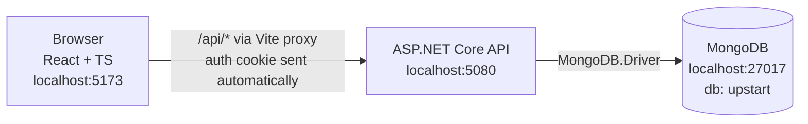
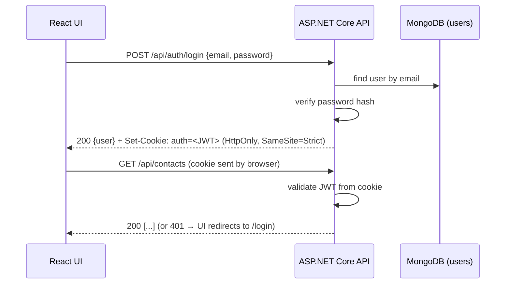

# Upstart Boilerplate — Implementation Plan

_As of 2026-11-15 · Status: revised after review (API authentication added, latest versions; UI login pages deferred)_

## 1. Goal and scope

One repo with a C# .NET API, MongoDB and a React + TypeScript UI. It's built so a new entity takes 3 small files, or one command, instead of a hand-written stack.

Done means the app can:

- **Render a page:** a home page with nav, plus one generated page per entity.
- **Handle a form submission:** a form built from config posts JSON, and server-side validation errors show next to it.
- **Interact with the database:** create, list, update and delete documents in MongoDB, plus a health check that pings the DB.
- **Authenticate users (API only):** register, log in, log out and "who am I" endpoints. API endpoints are protected by default and tested through Swagger and curl.

Out of scope for this first pass: **UI login and register pages (follow-up, section 11)**, Docker, CI, automated tests beyond a smoke run, deployment, and third-party login (Google, GitHub and similar).

## 2. Current state

| Item | State |
| --- | --- |
| Project folder | Draft files written to `api/`, `web/`, `scripts/` (no auth yet; they'll be updated to match this plan) |
| .NET SDK | **Not installed** (blocks building/running the API) |
| Node / npm | v22.23.1 / 10.9.8 installed |
| MongoDB | `mongodb-community@5.0` installed via Homebrew, `mongosh` available |
| `npm install` | Not run |
| Git | Folder is not a git repo yet |

## 3. Versions

Every dependency uses the **latest stable release at install time**, pinned exactly in `Api.csproj` and `package-lock.json`.

| Layer | Package |
| --- | --- |
| Runtime | Latest GA .NET SDK (the `TargetFramework` follows it, e.g. `net10.0`) |
| API | `MongoDB.Driver`, `Microsoft.AspNetCore.Authentication.JwtBearer`, OpenAPI UI (built-in `Microsoft.AspNetCore.OpenApi` + Swagger/Scalar UI) |
| Database | Latest MongoDB Community via Homebrew (upgrade from 5.0, which is past end-of-life) |
| Web | Latest React, React DOM, React Router, Vite, `@vitejs/plugin-react`, TypeScript |

## 4. Architecture



The UI only ever calls relative `/api/...` URLs. Vite proxies them to the API, so browser and API share one origin. That lets the auth cookie stay `HttpOnly` + `SameSite=Strict` with no CORS credential setup.

### Folder layout

```
Upstart Project/
├── PLAN.md, README.md, .gitignore
├── scripts/
│   └── new-resource.mjs          # scaffolds model + controller + UI config
├── api/
│   ├── Api.csproj
│   ├── Program.cs                # DI, auth, CORS, OpenAPI, rate limiting
│   ├── appsettings.json          # Mongo, Jwt (no secret), CORS, port
│   ├── appsettings.Development.json  # dev-only JWT key
│   ├── Data/
│   │   ├── MongoSettings.cs
│   │   ├── MongoContext.cs       # one MongoClient, Collection<T>(), index setup
│   │   └── CollectionAttribute.cs
│   ├── Models/
│   │   ├── BaseEntity.cs         # Id, CreatedAt, UpdatedAt
│   │   ├── User.cs               # Email, PasswordHash, Roles
│   │   └── Contact.cs            # sample schema
│   ├── Auth/
│   │   ├── JwtSettings.cs
│   │   ├── TokenService.cs       # issues signed JWTs
│   │   └── AuthDtos.cs           # RegisterRequest, LoginRequest, UserDto
│   ├── Repositories/
│   │   ├── IRepository.cs
│   │   └── MongoRepository.cs
│   └── Controllers/
│       ├── CrudController.cs     # generic REST, [Authorize] by default
│       ├── AuthController.cs     # register / login / logout / me
│       ├── ContactsController.cs # 1 line, [AllowAnonymous] (public demo form)
│       └── HealthController.cs   # public, pings Mongo
└── web/
    └── src/
        ├── types.ts
        ├── api/client.ts         # crudApi<T>(), readable 401 message
        ├── hooks/useResource.ts
        ├── components/DynamicForm.tsx, DataTable.tsx
        ├── pages/
        │   ├── HomePage.tsx
        │   └── ResourcePage.tsx
        ├── resources/index.ts, contacts.ts
        └── App.tsx, main.tsx, styles.css
```

## 5. Backend design (C# / ASP.NET Core)

The reusable pieces are written once. Each entity then needs only a model class and a one-line controller.

| Piece | Responsibility |
| --- | --- |
| `BaseEntity` | `Id` (stored as ObjectId, exposed as string), `CreatedAt`, `UpdatedAt`. Every schema inherits it. |
| `MongoContext` | Singleton holding one `MongoClient`. `Collection<T>()` resolves the collection name from `[Collection("x")]`, falling back to the lower-cased type name + `s`. It also creates indexes on startup, such as a unique index on email. |
| `IRepository<T>` / `MongoRepository<T>` | `GetAll` (newest first), `GetById`, `Create`, `Update`, `Delete`. It sets timestamps, keeps `CreatedAt` on update, and returns not-found for malformed ids. |
| DI registration | `AddScoped(typeof(IRepository<>), typeof(MongoRepository<>))`: one line covers every entity. |
| `CrudController<T>` | Abstract, `[ApiController]`, `[Authorize]`, route `api/[controller]`. Actions are `virtual`. |
| Validation | DataAnnotations on the model. `[ApiController]` returns 400 `ValidationProblemDetails` automatically. |
| `HealthController` | `[AllowAnonymous]` `GET /api/health` runs Mongo `ping`. |
| Config | `appsettings.json` plus per-environment files or env vars (`Mongo__ConnectionString`, `Jwt__Key`). |
| API docs | OpenAPI document + UI in Development, with a bearer/cookie auth button. |

### Endpoints generated per entity (sign-in required by default)

| Method | Route | Result |
| --- | --- | --- |
| GET | `/api/{plural}` | 200 list / 401 |
| GET | `/api/{plural}/{id}` | 200 / 401 / 404 |
| POST | `/api/{plural}` | 201 / 400 / 401 |
| PUT | `/api/{plural}/{id}` | 200 / 400 / 401 / 404 |
| DELETE | `/api/{plural}/{id}` | 204 / 401 / 404 |

## 6. Authentication

The API stores email + password users in MongoDB and issues a signed JWT in an `HttpOnly` cookie. Every API endpoint requires sign-in unless it opts out.

### Flow



### Backend pieces

| Piece | Detail |
| --- | --- |
| `User` model | `Email` (unique index, stored lower-case), `PasswordHash`, `Roles` (default `["User"]`). The hash is never serialized to responses; `UserDto` is returned instead. |
| Password hashing | ASP.NET Core's built-in `PasswordHasher<User>` (PBKDF2, salted, versioned). No extra package. |
| `TokenService` | Issues an HS256 JWT with `sub`, `email` and `role` claims. Lifetime comes from config (default 8 hours). |
| JWT validation | `AddAuthentication().AddJwtBearer(...)`. The token is read from the `auth` cookie via `OnMessageReceived`, with a fallback to an `Authorization: Bearer` header for API clients and Swagger. |
| Secret | `Jwt:Key` is **not** in `appsettings.json`. Dev uses `appsettings.Development.json` (git-ignored) or `dotnet user-secrets`; production uses the `Jwt__Key` env var. Startup fails fast if it's missing or shorter than 32 bytes. |
| Rate limiting | The built-in rate limiter on `/api/auth/login` and `/register` (e.g. 10 requests/minute per IP). |
| Password rules | Minimum 8 characters, enforced with DataAnnotations on `RegisterRequest`. |
| Error messages | Login failures return a generic "Invalid email or password" so they don't reveal which emails exist. |

### Auth endpoints

| Method | Route | Access | Result |
| --- | --- | --- | --- |
| POST | `/api/auth/register` | public | 201 `{user}` + cookie / 400 / 409 email taken |
| POST | `/api/auth/login` | public | 200 `{user}` + cookie / 401 |
| POST | `/api/auth/logout` | public | 204, clears cookie |
| GET | `/api/auth/me` | signed in | 200 `{user}` / 401 |

### Controlling access per resource

```csharp
// Default: any signed-in user.
public class ProductsController(IRepository<Product> r) : CrudController<Product>(r);

// Public resource (the sample Contacts form uses this until the UI has a login page):
[AllowAnonymous]
public class ContactsController(IRepository<Contact> r) : CrudController<Contact>(r);

// Admin only:
[Authorize(Roles = "Admin")]
public class ReportsController(IRepository<Report> r) : CrudController<Report>(r);
```

### Testing auth without a UI

- **Swagger:** call `/api/auth/register` or `/login`. The browser stores the cookie for `localhost:5080`, so later calls on the Swagger page are signed in.
- **curl:** use a cookie jar.
  ```bash
  curl -c jar -H 'Content-Type: application/json' -d '{"email":"a@b.com","password":"secret123"}' localhost:5080/api/auth/login
  curl -b jar localhost:5080/api/products
  ```
- **Other clients:** send the JWT in an `Authorization: Bearer` header instead of the cookie.

### UI in this pass

The UI has no sign-in yet. Public resources (Contacts) work fully. A page for a protected resource shows "Sign-in required (401)" instead of crashing.

## 7. Frontend design (React + TypeScript)

A single `ResourceConfig` object describes an entity. Routing, nav, the form, the table and API calls all read that config.

```ts
const contacts: ResourceConfig<Contact> = {
  key: 'contacts',
  title: 'Contacts',
  endpoint: '/api/contacts',
  fields: [
    { name: 'name',    label: 'Name',    required: true },
    { name: 'email',   label: 'Email',   type: 'email', required: true },
    { name: 'message', label: 'Message', type: 'textarea' },
  ],
};
```

| Piece | Responsibility |
| --- | --- |
| `types.ts` | `Entity`, `FieldConfig<T>` (`name` is type-checked against entity keys), `ResourceConfig<T>`. Field types: `text`, `email`, `password`, `number`, `textarea`, `checkbox`, `date`. |
| `api/client.ts` | `crudApi<T>(endpoint)` returns typed CRUD calls. It flattens ASP.NET validation errors into one message. |
| `hooks/useResource.ts` | Holds `items`, `loading` and `error`. Mutations reload the list. |
| `DynamicForm` / `DataTable` | Render from `fields`. |
| `ResourcePage` | Form + table for any config. |
| `resources/index.ts` | Registry. Adding a config creates its route and nav link. |

## 8. Adding a new resource

### Option A: one command

```bash
node scripts/new-resource.mjs Product name:string! price:number inStock:bool description:text
node scripts/new-resource.mjs Faq question:string! answer:text! --public
```

Field types: `string`, `text`, `email`, `number`, `bool`, `date`. Append `!` to make a field required. `--public` adds `[AllowAnonymous]` to the controller.

It creates the model, the controller, the UI config and the registry entry. It refuses to overwrite existing files. After running it, restart the API.

### Option B: by hand

Copy `Contact.cs`, `ContactsController.cs` and `contacts.ts`, rename them, and add the import to `resources/index.ts`.

## 9. Implementation steps and verification

1. **Prerequisites**
   - Install the latest .NET SDK.
   - Upgrade MongoDB to the latest Community release.
   - Start MongoDB.
   - Check: `mongosh --eval "db.runCommand({ping:1})"` returns `ok: 1`.
2. **API core**
   - Update the target framework and packages to latest.
   - Run `dotnet build`.
   - Check: `GET /api/health` returns 200.
3. **API auth**
   - Add the User model, password hashing, TokenService, AuthController, JWT-from-cookie, rate limiting, and `[Authorize]` on CrudController.
   - Check: `GET /api/contacts` without signing in returns 401.
   - Check: register returns 201 and a cookie.
   - Check: registering the same email again returns 409.
   - Check: login with a wrong password returns 401.
   - Check: login with the right password, then `GET /api/contacts` with the cookie, returns 200.
   - Check: logout, then `GET /api/contacts`, returns 401.
   - Check: `db.users.find()` shows a hash and no plaintext password.
4. **Web**
   - Upgrade to the latest packages and run `npm install && npm run build`.
   - Check: the home page shows the DB as connected.
   - Check: submitting the Contacts form adds a row, and the record is in Mongo.
   - Check: an invalid submit shows the server error.
   - Check: Delete removes the row.
5. **Scaffolder**
   - Generate a protected `Product` and a `--public` `Faq`, then build both apps.
   - Check: `/api/faqs` returns 200 without a cookie, and `/api/products` returns 401 without one and 200 with one.
   - Check: the Products page shows "Sign-in required".
   - Remove the test files afterwards.
6. **Docs and repo**
   - Write a README covering run commands, auth setup (`Jwt__Key`) and adding a resource.
   - Run `git init` and make a first commit.

## 10. Decisions (confirmed or defaulted)

| # | Decision | Choice |
| --- | --- | --- |
| D1 | Versions | Latest stable of everything, pinned at install |
| D2 | Scaffold script | Included, with a `--public` flag |
| D3 | Edit-in-place in the UI | Not in v1 (the API supports PUT) |
| D4 | Auth method | Email + password, JWT in an HttpOnly cookie |
| D5 | Roles | `User` by default. `Admin` is assigned manually in Mongo for now. |
| D6 | Per-user data ownership (users see only their own records) | Not in v1: signed-in users share data. It can be added later as an `OwnedEntity` base class that filters by user id. |
| D7 | Password reset / email verification | Not in v1 (needs an email provider) |
| D8 | Git | `git init` + first commit at the end |
| D9 | UI login / register | Deferred to a follow-up. The sample Contacts resource is public so the UI demo works. |

## 11. Follow-up: UI authentication

This is already supported by the API above, so it needs no backend changes.

| Piece | Detail |
| --- | --- |
| `AuthContext` | Calls `/api/auth/me` on load to restore the session. Exposes `user`, `login`, `register` and `logout`. The browser holds the cookie; the UI never touches the token. |
| `RequireAuth` | Route guard that redirects to `/login?next=...` when signed out. |
| `LoginPage` / `RegisterPage` | Built from `DynamicForm` field configs. |
| `api/client.ts` | A 401 clears the auth state and redirects to login. |
| `ResourceConfig.public` | Flag that skips the guard, matching `[AllowAnonymous]`. |
| Nav | Shows the user's email and Logout, or Login/Register. |
